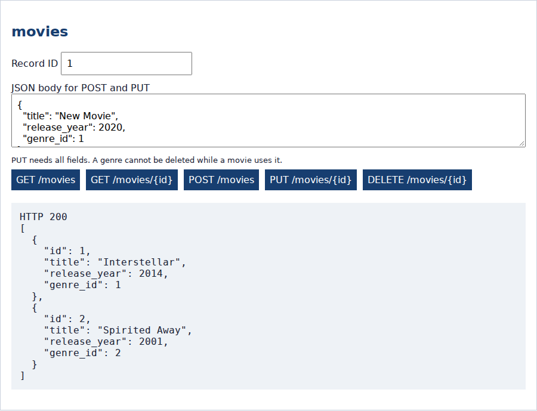
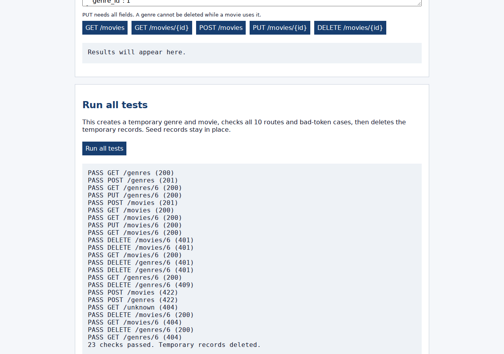

# NGINX Deployment

Movie Collection API

Basil Wazwaz | ASE 230 Project 1

---

## Deployment setup

The local deployment uses:

- MySQL for movies and genres.
- PHP-FPM to run the API code.
- NGINX to receive HTTP requests on port 8081.

NGINX forwards the path, body, method, and Authorization header.
The API handles the request and returns JSON.

---

## Install and prepare

Ubuntu 24.04 example:

```bash
sudo apt install nginx php-fpm php-mysql mysql-server
sudo systemctl start mysql
sudo mysql < code/schema.sql
sudo mkdir -p /var/www/movie-api/code
sudo cp code/* /var/www/movie-api/code/
```

Create the database user using README.md.
Do not use the MySQL root account for the API.

---

## NGINX server configuration

Save `code/nginx.conf.example` as
`/etc/nginx/sites-available/movie-api`.

```nginx
server {
    listen 127.0.0.1:8081;
    server_name localhost;
    root /var/www/movie-api/code;
    # Locations are shown on the next slide.
}
```

The root path must match the location of the PHP files.

---

## Routing to PHP-FPM

Inside the server block:

```nginx
location = /test_client.html { default_type text/html; }
location / {
    include fastcgi_params;
    fastcgi_param SCRIPT_FILENAME $document_root/index.php;
    fastcgi_param HTTP_AUTHORIZATION $http_authorization;
    fastcgi_pass unix:/run/php/php8.3-fpm.sock;
}
```

Only the test client is served as a static file.
Source: NGINX FastCGI documentation, linked in README.md.

---

## Configure PHP-FPM

Edit `/etc/php/8.3/fpm/pool.d/www.conf`.
Add these under the existing `[www]` pool:

```ini
env[DB_HOST] = 127.0.0.1
env[DB_PORT] = 3306
env[DB_USER] = movie_app
env[DB_PASSWORD] = YOUR_LOCAL_PASSWORD
env[API_TOKEN] = YOUR_LOCAL_TOKEN
```

Use your own local values. Keep them outside GitHub.
Adjust the PHP version in the socket and service if needed.

---

## Enable and start

```bash
sudo ln -s /etc/nginx/sites-available/movie-api \
  /etc/nginx/sites-enabled/movie-api
sudo php-fpm8.3 -t
sudo nginx -t
sudo systemctl restart php8.3-fpm nginx
curl -i http://localhost:8081/movies
```

A working response has status 200 and movie JSON.
Check that the HTTP Server header identifies NGINX.

---

## Working API capture



Real GET /movies result from the browser client through NGINX on port 8081.
The response header was also checked for `nginx/1.24.0`.

---

## Browser test capture



The same browser suite passed through NGINX.

---

## Test results

```bash
BASE_URL=http://localhost:8081 bash code/test_curl.sh
```

- cURL: 29 checks passed through NGINX.
- Browser: 23 checks passed through NGINX.
- Missing and wrong tokens returned 401 on both delete routes.
- A genre in use returned 409.
- Deleted records returned 404 on later reads.

See `verification.md` for the exact tested environment.

---

## Troubleshooting and stopping

502: Check PHP-FPM is running and its socket matches NGINX.

500: Check the database user, password, and schema import.

401: Check the request token matches PHP-FPM's API_TOKEN.
Restart FPM after changing pool settings.

```bash
sudo systemctl stop nginx php8.3-fpm
```

The deployment is local. It is not a public hosted website.

---

## Sources

- Supplied Project 1 overview, deployment requirements.
- NGINX: Module `ngx_http_fastcgi_module`.
  https://nginx.org/en/docs/http/ngx_http_fastcgi_module.html
- PHP: Runtime Configuration (PHP-FPM).
  https://www.php.net/manual/en/install.fpm.configuration.php
- MySQL 8.0 Reference Manual: FOREIGN KEY Constraints.
  https://dev.mysql.com/doc/refman/8.0/en/create-table-foreign-keys.html

Screenshots are from the working local project.
